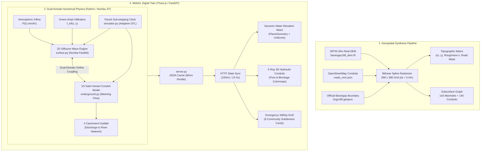

# Barangay 168 (Deparo, Caloocan City) 3D Flood Simulation System

[](https://www.python.org/)
[](https://fastapi.tiangolo.com/)
[](https://numba.pydata.org/)
[](https://threejs.org/)
[]()

A physics-based, dual-domain urban flood simulation digital twin for **Barangay 168 (Deparo, Caloocan City, Metro Manila, Philippines)**. The system pairs a high-performance **2D diffusive-wave shallow water surface engine** with a coupled **1D underground storm-drainage pipe network**, rendered in real time through an interactive WebGL / Three.js frontend.

---

## Table of Contents

1. [System Architecture](#system-architecture)
2. [Global Physical Constants & Parameters](#global-physical-constants--parameters)
3. [Hydrologic & Hydraulic Physics Engine](#hydrologic--hydraulic-physics-engine)
   - [3.1 Surface Water Dynamics (2D Diffusive Wave)](#31-surface-water-dynamics-2d-diffusive-wave)
   - [3.2 Infiltration & Impervious Land Cover](#32-infiltration--impervious-land-cover)
   - [3.3 Dual-Domain Coupling (Inlet Grates)](#33-dual-domain-coupling-inlet-grates)
   - [3.4 Surcharge Backflow & Urban Geysering](#34-surcharge-backflow--urban-geysering)
   - [3.5 1D Conduit Network Hydraulics](#35-1d-conduit-network-hydraulics)
   - [3.6 Free River Catchment Outfalls](#36-free-river-catchment-outfalls)
   - [3.7 Dual-Domain Mass Conservation](#37-dual-domain-mass-conservation)
4. [Simulation Timing & Temporal Scaling](#simulation-timing--temporal-scaling)
5. [GIS & Urban Synthesis Pipeline](#gis--urban-synthesis-pipeline)
6. [Emergency Management & SitRep Zones](#emergency-management--sitrep-zones)
7. [System Performance & Optimization Stack](#system-performance--optimization-stack)
8. [Directory & File Structure](#directory--file-structure)
9. [REST API Specification](#rest-api-specification)
10. [Installation & Verification](#installation--verification)

---

## System Architecture



---

## Global Physical Constants & Parameters

All physical constants, coefficients, and numerical limits used across the simulation engine are centralized below:

| Constant / Parameter | Symbol | Value | Units | Physical Description |
| :--- | :---: | :---: | :---: | :--- |
| **Gravitational Acceleration** | $g$ | $9.81$ | $\text{m/s}^2$ | Standard Earth gravitational acceleration |
| **Spatial Grid Resolution** | $\Delta x$ | $5.0$ | $\text{m}$ | Lateral dimension of square grid cell ($A_{\text{cell}} = 25\text{ m}^2$) |
| **Asphalt Road Roughness** | $n_{\text{road}}$ | $0.013$ | $\text{s/m}^{1/3}$ | Manning's roughness coefficient for smooth asphalt pavement |
| **Soil / Lawn Roughness** | $n_{\text{pervious}}$ | $0.040$ | $\text{s/m}^{1/3}$ | Manning's roughness coefficient for urban lawns and unpaved soil |
| **Concrete Pipe Roughness** | $n_{\text{pipe}}$ | $0.013$ | $\text{s/m}^{1/3}$ | Manning's coefficient for precast reinforced concrete culverts |
| **Infiltration Rate (Soil)** | $f_{\text{infil}}$ | $1.4 \times 10^{-6}$ | $\text{m/s}$ | Green-Ampt saturated hydraulic conductivity ($\approx 5.0\text{ mm/hr}$) |
| **Infiltration Rate (Road)** | $f_{\text{road}}$ | $0.0$ | $\text{m/s}$ | Zero infiltration through impermeable paved surfaces |
| **Min Flow Threshold** | $h_{\text{min}}$ | $0.02$ | $\text{m}$ | Microtopographic capillary detention threshold ($2\text{ cm}$) |
| **Cell Volumetric Flux Cap** | $F_{\text{cap}}$ | $0.10$ | $-$ | Maximum volume fraction allowed to leave a surface cell per step |
| **Inlet Discharge Coefficient**| $C_d$ | $0.60$ | $-$ | Orifice discharge coefficient for standard municipal storm grates |
| **Inlet Effective Area** | $A_{\text{inlet}}$ | $0.05$ | $\text{m}^2$ | Nominal clear hydraulic aperture area of street storm inlet |
| **Surcharge Grate Damping** | $F_{\text{damp}}$ | $0.10$ | $-$ | Maximum fraction of above-rim excess discharged per sub-step |

---

## Hydrologic & Hydraulic Physics Engine

### 3.1 Surface Water Dynamics (2D Diffusive Wave)

Overland runoff is governed by the **2D Shallow Water Equations (SWE)** under the **diffusive wave approximation**. By neglecting the convective and local acceleration terms in the Saint-Venant momentum equation, the water surface slope is balanced directly against friction resistance:

$$\mathbf{S}_f = -\nabla \eta = -\nabla (z + h)$$

Where:
- $\eta = z + h$ is the total hydraulic water surface elevation ($\text{m}$)
- $z$ is the bed ground elevation ($\text{m}$) from the Digital Elevation Model
- $h$ is the local surface water depth ($\text{m}$)
- $\mathbf{S}_f$ is the hydraulic friction slope vector

The directional discharge per unit width ($q_x, q_y$) across grid interfaces is derived from **Manning's open-channel equation**:

$$q_x = \frac{1}{n} \, h_{\text{interface}}^{5/3} \, \frac{-\frac{\partial \eta}{\partial x}}{\sqrt{\left|\frac{\partial \eta}{\partial x}\right|}} = \frac{1}{n} \, h_{\text{interface}}^{5/3} \sqrt{|S_{f,x}|} \cdot \text{sgn}(S_{f,x})$$

$$q_y = \frac{1}{n} \, h_{\text{interface}}^{5/3} \, \frac{-\frac{\partial \eta}{\partial y}}{\sqrt{\left|\frac{\partial \eta}{\partial y}\right|}} = \frac{1}{n} \, h_{\text{interface}}^{5/3} \sqrt{|S_{f,y}|} \cdot \text{sgn}(S_{f,y})$$

#### Interface Averaging & Numerical Guards

To guarantee numerical monotonicity, interface variables are evaluated using arithmetic mean approximations with explicit boundary limits:

$$h_{\text{interface}, x} = \frac{h_{r, c} + h_{r, c+1}}{2}, \qquad n_{\text{interface}, x} = \frac{n_{r, c} + n_{r, c+1}}{2}$$

$$\Delta V_x = \min\left(|q_x| \Delta t, \, F_{\text{cap}} \cdot h_{\text{source}} \cdot \Delta x\right) \cdot \text{sgn}(q_x)$$

> **Why Diffusive Wave?**  
> Full dynamic shallow water models (with Riemann solvers) suffer severe Courant–Friedrichs–Lewy (CFL) time-step restrictions ($\Delta t \le \Delta x / (u + \sqrt{gh})$), demanding millisecond steps. The diffusive wave approximation retains true backwater and topographic pooling physics while remaining unconditionally stable at steps up to $\Delta t = 10\text{ s}$, enabling fast-forward speeds $> 300\times$.

---

### 3.2 Infiltration & Impervious Land Cover

Infiltration loss through pervious terrain is modelled via a localized Green-Ampt parameterization:

$$\Delta h_{\text{infil}}(x, y) = \min\left(h(x, y), \, f(x, y) \cdot \Delta t\right)$$

$$f(x, y) = \begin{cases} 0.0 & \text{if } (x, y) \in \text{Road Mask} \\ 1.4 \times 10^{-6}\text{ m/s } (\approx 5.0\text{ mm/hr}) & \text{if } (x, y) \in \text{Pervious Soil} \end{cases}$$

Urban roads and paved highways are strictly impervious ($f = 0$), directing $100\%$ of rainfall into surface runoff and street gutters.

---

### 3.3 Dual-Domain Coupling (Inlet Grates)

Surface overland water couples into subterranean drainage manholes via curb-opening and gutter inlets using the standard **orifice discharge equation**:

$$Q_{\text{inflow}} = C_d \cdot A_{\text{inlet}} \cdot \sqrt{2g \cdot h}$$

#### Dynamic Pipe-Blockage Gating

Inlets cannot drain water if the connected conduit network is blocked. The effective intake capacity is throttled dynamically by the conduit openness factor $\Omega_j \in [0.0, 1.0]$:

$$\Omega_j = \max\left(0.0, \, 1.0 - \frac{1}{M} \sum_{k=1}^M B_k\right)$$

$$\Delta V_{\text{inflow}} = \min\left(Q_{\text{inflow}} \cdot \Delta t, \, h \cdot \Delta x^2\right) \cdot \Omega_j$$

Where $B_k \in [0.0, 1.0]$ represents the percentage blockage of pipe $k$. If downstream pipes are $100\%$ clogged ($B_k = 1.0$), $\Omega_j = 0$, completely halting drainage and forcing runoff to pool on the street.

---

### 3.4 Surcharge Backflow & Urban Geysering

When pipes exceed hydraulic capacity or severe backwater pressure develops, the Hydraulic Grade Line (HGL) in manhole $j$ can rise above the surface street rim:

$$\text{HGL}_j = z_{\text{invert}, j} + \frac{V_j}{A_{\text{shaft}, j}}$$

#### Trigger Criteria & Excess Volume

Water is pushed upward onto the street surface if and only if three physical criteria are simultaneously met:

$$\text{Active Surcharge} \iff \begin{cases} \text{HGL}_j \ge z_{\text{rim}, j} & \text{(Shaft water has reached surface rim)} \\ \text{HGL}_j > z_{\text{street}} + h_{\text{street}} & \text{(Piezometric head exceeds overland head)} \\ V_j > 10^{-6}\text{ m}^3 & \text{(Shaft contains water)} \end{cases}$$

When active, the unconstrained surcharge rate is:

$$Q_{\text{surch}} = C_d \cdot A_{\text{inlet}} \cdot \sqrt{2g \cdot \left(\text{HGL}_j - (z_{\text{street}} + h_{\text{street}})\right)}$$

#### Numerical Grate Damping & Oscillation Prevention

To eliminate artificial mass creation and discrete numerical ping-pong oscillations (fill $\to$ dump $\to$ refill), total surcharge volume is capped to $10\%$ of the physically available above-rim excess volume:

$$V_{\text{excess}} = \max\left(0.0, \, (\text{HGL}_j - z_{\text{rim}, j}) \cdot A_{\text{shaft}, j}\right)$$

$$\Delta V_{\text{surcharge}} = \min\left(\sum Q_{\text{surch}} \cdot \Delta t, \, F_{\text{damp}} \cdot V_{\text{excess}}\right), \qquad F_{\text{damp}} = 0.10$$

> **Why 10% Damping?**  
> Discharging $100\%$ of above-rim volume in a single discrete step creates numerical instability: water dumps onto the surface, raising surface head, then immediately drains back into the shaft on the next step. Damping at $10\%$ spreads the pressure relief smoothly over ~10 sub-steps, reflecting the real throttling of narrow manhole cover apertures.

---

### 3.5 1D Conduit Network Hydraulics

Underground drainage conduits transfer water between manholes driven by the hydraulic grade difference $\Delta H$:

$$\Delta H = H_{\text{in}} - H_{\text{out}} = \left(z_{\text{inv}, \text{in}} + \frac{V_{\text{in}}}{A_{\text{in}}}\right) - \left(z_{\text{inv}, \text{out}} + \frac{V_{\text{out}}}{A_{\text{out}}}\right)$$

The energy slope is:

$$S_f = \frac{|\Delta H|}{\max(L, 1.0)}$$

Full-pipe and partial-flow conveyance is governed by **Manning's pipe equation**:

$$Q_{\text{pipe}} = \text{sgn}(\Delta H) \cdot \frac{A_{\text{eff}} \cdot R_{\text{eff}}^{2/3} \cdot \sqrt{S_f}}{n_{\text{pipe}}}$$

Where:
- $A_{\text{eff}} = \frac{\pi D^2}{4} \cdot (1.0 - B)$ is the open cross-sectional flow area ($\text{m}^2$)
- $R_{\text{eff}} = \frac{A_{\text{eff}}}{\pi D (1.0 - B)}$ is the effective hydraulic radius ($\text{m}$)
- **Bidirectional Flow**: If $\Delta H < 0$, $Q_{\text{pipe}}$ becomes negative, naturally simulating backwater intrusion and reverse sewer flow.

#### Proportional Node Outflow Clamping

To prevent overdrafting when multiple conduits drain the same manhole simultaneously, a per-node scaling coefficient $\Lambda_j$ is enforced:

$$\Lambda_j = \min\left(1.0, \, \frac{V_j}{\sum_{\text{out}} |Q_k| \Delta t + 10^{-12}}\right)$$

$$Q_k \leftarrow Q_k \cdot \Lambda_{\text{source}}$$

This guarantees that manhole volume remains strictly non-negative ($V_j \ge 0$) under all hydraulic conditions.

---

### 3.6 Free River Catchment Outfalls

The conduit graph terminates at **4 designated catchment outlet nodes** positioned at the natural low-elevation stream boundaries of Barangay 168. Outfalls discharge directly into open river networks:

$$V_{\text{discharged}} = \sum_{m \in \text{outfalls}} V_m, \qquad V_m \leftarrow 0.0$$

Cumulative outfall discharge is continuously integrated into the system's global mass balance accounting.

---

### 3.7 Dual-Domain Mass Conservation

Total water mass across both surface and subterranean domains is rigorously conserved:

$$V_{\text{domain}}(t) = V_{\text{surface}}(t) + V_{\text{underground}}(t) = \sum_{r,c} h(r,c) \Delta x^2 + \sum_j V_j$$

The expected water balance is governed by:

$$V_{\text{expected}}(t) = V_{\text{rain\_cum}}(t) - V_{\text{drain\_cum}}(t)$$

Where $V_{\text{rain\_cum}}$ is cumulative precipitation over active barangay cells and $V_{\text{drain\_cum}}$ accounts for soil infiltration and river outfall discharges.

The normalized **Mass Balance Error Percentage** is:

$$\text{Error (\%)} = \frac{\left| V_{\text{domain}}(t) - V_{\text{expected}}(t) \right|}{\max\left(V_{\text{rain\_cum}}(t), \, V_{\text{domain}}(t), \, 1.0\right)} \times 100\%$$

> **Singularity-Free Normalization**: Normalizing by $\max(V_{\text{rain}}, V_{\text{domain}}, 1.0)$ ensures numerical robustness when precipitation ceases and floodwaters fully drain, eliminating division-by-zero artifacts.

---

## Simulation Timing & Temporal Scaling

The server employs a calibrated dual-mode time advancement engine to provide both realistic real-time pacing and high-throughput multi-hour forecast capabilities:

| Speed Multiplier | Step Size ($\Delta t$) | Pacing Mechanism | Effective Advance Rate | Typical Use Case |
| :---: | :---: | :--- | :---: | :--- |
| **$1\times$** | $0.05\text{ s}$ | Paced $20\text{ Hz}$ sleep ($50\text{ ms}$) | $1.0\text{ sim-sec / real-sec}$ | True real-time live monitoring |
| **$5\times$** | $0.25\text{ s}$ | Paced $20\text{ Hz}$ sleep ($50\text{ ms}$) | $5.0\text{ sim-sec / real-sec}$ | Hydrograph observation |
| **$25\times$** | $1.25\text{ s}$ | Paced $20\text{ Hz}$ sleep ($50\text{ ms}$) | $25.0\text{ sim-sec / real-sec}$ | Standard speed-up |
| **$100\times$** | $2.00\text{ s}$ | $150\text{ ms}$ wall-budget thread batch | $\approx 60 - 80\times$ | Rapid storm development |
| **$500\times$** | $5.00\text{ s}$ | $150\text{ ms}$ wall-budget thread batch | $\approx 150 - 200\times$ | Multi-hour rainfall events |
| **$1000\times - 2000\times$** | $8.00\text{ s}$ | $150\text{ ms}$ wall-budget thread batch | $\approx 250\times$ | Long-term inundation analysis |
| **$5000\times - 10000\times$** | $10.00\text{ s}$ | $150\text{ ms}$ wall-budget thread batch | $> 300\times$ | Fast-forwarding drainage & dry-out |

---

## GIS & Urban Synthesis Pipeline

The terrain and infrastructure model of Barangay 168 is procedurally generated from authoritative open geospatial data:

```
data/
├── barangay168_dem.tif   # Real SRTM 30m Digital Elevation Model (Caloocan North)
├── brgy168.geojson       # Official boundary polygon for Barangay 168 (Deparo)
└── roads_osm.json        # Real OpenStreetMap road network geometry (1,965 segments)
```

1. **Topographic Grid**:
   - Grid dimensions: **$690 \times 380$ cells** ($\Delta x = 5.0\text{ m}$, total $262,200$ cells).
   - Official Barangay 168 footprint: **$93,531$ active cells** ($35.7\%$ of domain).
   - Elevation range: **$4.36\text{ m}$** (southwest lowlands) to **$65.06\text{ m}$** (eastern ridges), mean elevation $33.25\text{ m}$.
2. **Road Infrastructure**:
   - 1,965 real OpenStreetMap road segments rasterized with width priority.
3. **Storm Drainage Graph**:
   - 143 manhole junction nodes placed at intersections and topographic sinks.
   - 145 precast concrete conduits ($D = 0.6\text{ m} - 1.2\text{ m}$, adjustable up to $5.0\text{ m}$).
   - 4 designated river catchment discharge outfalls.
4. **Buildings & Foliage**:
   - 9,971 street-frontage building footprints with realistic setbacks.
   - 1,749 natural trees placed across open fields and vegetative buffers.

---

## Emergency Management & SitRep Zones

Barangay 168 is partitioned into 8 subdivision zones, continuously tracked for disaster response:

| Subdivision / Zone Name | Area (ha) | Topographic Profile | Critical Inundation Hotspots |
| :--- | :---: | :--- | :--- |
| **Deparo Proper (Sentro)** | 26.38 | Commercial arterial hub, mid-elevation | Deparo Road & Sentro intersections |
| **Sto. Thomas & Casimiro** | 29.29 | Dense residential lowland basin | Casimiro Townhomes & Sto. Thomas Village |
| **Nova Romania** | 24.42 | Mid-elevation terrace community | Internal residential cul-de-sacs |
| **Alecon & Narra (Woodridge)** | 21.77 | Steep valley bowl; primary natural depression | Narra Street & Woodridge sink |
| **Precious Ruby & Natividad** | 28.27 | Central residential community | Natividad Street & Precious Ruby sector |
| **Metro Green & Camarin** | 49.08 | Largest zone; arterial runoff corridors | Camarin Road boundary corridors |
| **BF Homes Phase III** | 40.77 | Elevated ridge terrain | Outfall perimeter buffers |
| **Camella Altezza** | 13.84 | Western terrace development | Altezza perimeter slope base |

### Severity Classifications

The SitRep dashboard dynamically updates community flood status based on **active, real-time depth** ($h_{\text{current}}$), while the historical maximum is preserved independently in the **Peak Depth** column:

| Status Badge | Current Depth ($h$) | Physical Impact | Emergency Action Required |
| :---: | :---: | :--- | :--- |
| 🟢 **NORMAL** | $< 0.10\text{ m}$ | Passable; road gutter flow | Routine monitoring |
| 🟡 **ALERT** | $0.10\text{ m} - 0.30\text{ m}$ | Ankle-deep ponding; gutter overflow | Traffic advisory issued |
| 🟠 **WARNING** | $0.30\text{ m} - 0.80\text{ m}$ | Knee-to-waist deep; light vehicles stalled | Evacuation preparation; emergency standby |
| 🔴 **CRITICAL** | $\ge 0.80\text{ m}$ | Waist to overhead; structural flooding | Mandatory rescue and evacuation |

---

## System Performance & Optimization Stack

To maintain fluid 60 FPS graphics alongside computationally intensive 2D shallow water physics, the system implements a 4-tier optimization pipeline:

1. **Parallel Numba JIT Compilation (`surface.py`)**:
   - Overland diffusive wave fluxes are executed in parallel across CPU cores (`parallel=True, nogil=True`).
   - Inner loops vectorize without Python interpreter overhead.
2. **Server JSON Byte Caching (`server.py`)**:
   - Global simulation state serialization is throttled to $12.5\text{ Hz}$ ($80\text{ ms}$ wall budget).
   - If the sim tick is unchanged, pre-encoded JSON bytes are returned instantly via FastAPI `Response(content=...)`, eliminating redundant serialization.
3. **Frontend Poll Rate & Texture Dirty-Checking (`index.html`)**:
   - Client polling is tuned to $10\text{ Hz}$ ($100\text{ ms}$), halving browser garbage collection pressure.
   - Canvas 2D zone label textures only redraw when text or status changes (`_lastText !== text`), preventing redundant GPU texture uploads.
4. **Adaptive Snapshot Stride**:
   - Snapshot recording interval scales proportionally with `sim_speed` ($\text{interval} = \max(30.0, \, \text{sim\_speed} \cdot 2.0)$), ensuring consistent memory consumption during multi-hour fast-forwards.

---

## Directory & File Structure

```
Flood Control/
├── data/
│   ├── .gitkeep
│   ├── barangay168_dem.tif      # Real SRTM 30m Digital Elevation Model
│   ├── brgy168.geojson          # Official boundary polygon for Barangay 168
│   └── roads_osm.json           # Real OSM road network (1,965 features)
│
├── src/
│   ├── __init__.py
│   ├── server.py                # FastAPI backend, simulation thread, REST API & JSON cache
│   ├── engine/
│   │   ├── __init__.py
│   │   ├── simulator.py         # Sub-stepping time orchestrator with dynamic CFL limits
│   │   ├── state.py             # SimulationState dataclass (arrays, pipes, telemetry)
│   │   ├── surface.py           # 2D Shallow Water Equations (diffusive wave via Numba JIT)
│   │   └── underground.py       # 1D Saint-Venant hydraulic pipe network (Manning flow)
│   └── utils/
│       ├── __init__.py
│       └── city_builder.py      # Procedural GIS synthesis: DEM, roads, buildings, pipes
│
├── static/
│   ├── index.html               # Three.js 3D WebGL digital twin, telemetry HUD, inspector
│   ├── terrain_grass.png        # Procedural baked high-resolution terrain texture
│   └── terrain_roads.png        # Procedural baked road overlay texture
│
├── tests/
│   ├── .gitkeep
│   ├── test_simulation_zones.py # Subdivision boundary and zonal depth audit
│   └── verify_full_engine.py    # 6-part full physics, hydrology, and mass balance test suite
│
├── .gitattributes
├── .gitignore
├── CONTRIBUTING.md
├── LICENSE
├── main.py                      # Application launcher (Uvicorn on port 8000)
├── README.md                    # System architecture & physics documentation
└── requirements.txt             # Python dependencies
```

---

## REST API Specification

### State & Geometry
- **`GET /api/terrain`**: Returns elevation matrix, road masks, building/tree geometries, pipe network topology, and subdivision boundaries.
- **`GET /api/state`**: Returns current 1D flat water depth array, telemetry, pipe flows, node heads, and subdivision SitRep statuses.

### Simulation Control
- **`POST /api/control`**: Toggles simulation running state (Play / Pause).
- **`POST /api/speed`**: Sets time multiplier (`multiplier`: $1, 5, 25, 100, 500, 1000, 2000, 5000, 10000$).
- **`POST /api/reset`**: Resets all surface water, pipe volumes, and telemetry back to dry conditions.

### Weather & Hydrology
- **`POST /api/rainfall`**: Sets continuous precipitation rate in $\text{mm/hr}$ and optional auto-stop duration:
  ```json
  { "mm_per_hr": 100.0, "duration_sim_hours": 2.0 }
  ```
- **`POST /api/scenario`**: Applies preset weather scenarios (e.g., Habagat storm, Typhoon Ondoy, severe pipe blockage).

### Pipe Engineering
- **`POST /api/pipe/{id}/blockage`**: Sets individual conduit blockage percentage ($0.0 - 1.0$).
- **`POST /api/pipes/bulk_blockage`**: Applies blockage across a group of pipe IDs.
- **`POST /api/pipe/{id}/diameter`**: Resizes conduit diameter ($0.1\text{ m} - 5.0\text{ m}$).
- **`POST /api/pipes/bulk_diameter`**: Bulk-resizes culvert diameters across geographic sectors.

---

## Installation & Verification

### 1. Setup Virtual Environment

```powershell
python -m venv venv
.\venv\Scripts\Activate.ps1
pip install -r requirements.txt
```

### 2. Run Verification Suite

To verify numerical accuracy, mass conservation, and pipe hydraulics across all 6 test stages:

```powershell
python tests/verify_full_engine.py
```

Expected output:
```
=================================================================
  ALL SYSTEMS OPERATIONAL: Engine, Physics, Pipes, Water Depth   
  Topography, SitRep, & Mass Balance Are 100% Working & Accurate! 
=================================================================
```

### 3. Launch Digital Twin

```powershell
python main.py
```

Access the WebGL simulation interface in your browser:  
👉 **`http://localhost:8000`**
