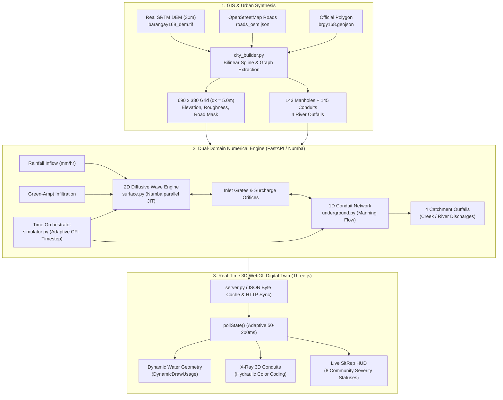

# Barangay 168 (Deparo, Caloocan City) 3D Flood Simulation System

A physics-based, dual-domain urban flood simulation digital twin for **Barangay 168 (Deparo, Caloocan City, Metro Manila, Philippines)**. The system pairs a high-performance **2D diffusive-wave shallow water surface engine** with a coupled **1D underground storm-drainage pipe network**, rendered in real time through an interactive WebGL / Three.js frontend.

---

## Table of Contents

1. [System Architecture](#system-architecture)
2. [Hydrologic & Hydraulic Physics Engine](#hydrologic--hydraulic-physics-engine)
   - [1. Surface Water Dynamics (Diffusive Wave Equation)](#1-surface-water-dynamics-diffusive-wave-equation)
   - [2. Infiltration & Land Cover Losses](#2-infiltration--land-cover-losses)
   - [3. Dual-Domain Coupling (Surface ↔ Underground Inlets)](#3-dual-domain-coupling-surface--underground-inlets)
   - [4. Surcharge Backflow (Urban Geysering)](#4-surcharge-backflow-urban-geysering)
   - [5. 1D Underground Conduit Hydraulics (Manning Flow)](#5-1d-underground-conduit-hydraulics-manning-flow)
   - [6. Free Outfall Discharges](#6-free-outfall-discharges)
   - [7. Mass Balance & Conservation of Mass](#7-mass-balance--conservation-of-mass)
3. [GIS & Urban Infrastructure Pipeline](#gis--urban-infrastructure-pipeline)
4. [Community Subdivisions (SitRep Zones)](#community-subdivisions-sitrep-zones)
5. [Simulation Timing & Fast-Forward Engine](#simulation-timing--fast-forward-engine)
6. [Directory & File Structure](#directory--file-structure)
7. [API Specification](#api-specification)
8. [Getting Started & Installation](#getting-started--installation)
9. [Engine Verification & Quality Assurance](#engine-verification--quality-assurance)

---

## System Architecture



---

## Hydrologic & Hydraulic Physics Engine

### 1. Surface Water Dynamics (Diffusive Wave Equation)

The overland flow model solves the **2D Shallow Water Equations (SWE)** using the **diffusive wave approximation**. By neglecting the inertial terms in the Saint-Venant momentum equation, the water surface gradient is balanced directly against bottom friction (Manning's equation):

$$S_f = -\nabla \eta = -\nabla (z + h)$$

Where:
- $\eta = z + h$ is the total hydraulic head / water surface elevation ($m$)
- $z$ is the bed ground elevation ($m$) from the Digital Elevation Model
- $h$ is the local water depth ($m$)
- $S_f$ is the friction slope

The directional unit discharge $q_x, q_y$ ($m^2/s$) across grid cell interfaces is derived from **Manning's open-channel formula**:

$$q_x = \frac{1}{n} h_{\text{interface}}^{5/3} \sqrt{|S_{f,x}|} \cdot \text{sgn}(S_{f,x})$$

$$q_y = \frac{1}{n} h_{\text{interface}}^{5/3} \sqrt{|S_{f,y}|} \cdot \text{sgn}(S_{f,y})$$

Where:
- $n$ is Manning’s roughness coefficient:
  - $n = 0.013$ on paved asphalt roads
  - $n = 0.040$ on soil, residential lots, and vegetated open space
- $h_{\text{interface}} = \frac{h_i + h_{i+1}}{2}$ is the average interface water depth.

#### Numerical Implementation & Stability
- **Threshold Gate**: Below $h < 0.02\text{ m}$ (2 cm), surface tension and microtopographic friction immobilize the water ($q = 0$), preventing unphysical numerical creep over dry cells.
- **Volumetric Flux Limiting**: At any given timestep, the maximum flux leaving a grid cell is clamped to $10\%$ of its active volume ($F_{\text{cap}} = 0.10 \cdot h$), guaranteeing unconditional stability against negative depths:
  $$\Delta V_x = \min(q_x \Delta t, 0.10 \cdot h \cdot \Delta x)$$
- **Boundary Invariant**: All cells outside the official Barangay 168 polygon boundary are clipped ($h = 0$) after each time step.

---

### 2. Infiltration & Land Cover Losses

Ground infiltration is calculated using a simplified **Green-Ampt infiltration abstraction**:

$$\Delta h_{\text{infil}} = \min(h, f_{\text{rate}} \cdot \Delta t)$$

- **Impervious Road Mask ($n_{\text{road}} = \text{True}$)**: $f_{\text{rate}} = 0.0\text{ m/s}$ (zero infiltration through paved street surfaces).
- **Urban Pervious Soils ($n_{\text{road}} = \text{False}$)**: $f_{\text{rate}} = 1.4 \times 10^{-6}\text{ m/s}$ ($\approx 5.0\text{ mm/hr}$). This matches dense, compacted clay-loam urban residential soils characteristic of northern Caloocan City.

---

### 3. Dual-Domain Coupling (Surface ↔ Underground Inlets)

Surface water drains into underground manhole shafts through curb inlets and street storm grates. The transfer rate is modelled via the **standard orifice discharge equation**:

$$Q_{\text{inflow}} = C_d \cdot A_{\text{inlet}} \cdot \sqrt{2g \cdot h}$$

Where:
- $C_d = 0.60$ is the standard discharge coefficient for municipal storm grates.
- $A_{\text{inlet}} = 0.05\text{ m}^2$ is the nominal effective intake grate area.
- $g = 9.81\text{ m/s}^2$ is gravitational acceleration.

#### Pipe-Blockage Gating
Water cannot enter a manhole if the connected underground pipe network is blocked. The inlet capacity is dynamically throttled by the downstream conduit openness:

$$\Omega_{\text{node}} = \max\left(0, 1.0 - \frac{1}{M} \sum_{k=1}^M B_k\right)$$

$$V_{\text{inflow}} = \min\left(Q_{\text{inflow}} \cdot \Delta t, h \cdot \Delta x^2\right) \cdot \Omega_{\text{node}}$$

Where $B_k \in [0, 1]$ is the percentage blockage of connected pipe $k$. When pipes are 100% blocked ($B = 1.0$), $\Omega_{\text{node}} = 0.0$, completely preventing surface floodwater from disappearing into clogged underground drains.

---

### 4. Surcharge Backflow (Urban Geysering)

When underground conduits exceed full capacity or backwater pressure builds up, the hydraulic grade line (HGL) at manhole $j$ can exceed both the street ground elevation and the local water surface:

$$\text{HGL}_j = z_{\text{invert}, j} + \frac{V_j}{A_{\text{shaft}, j}}$$

Water can **only** be pushed upwards onto the street when three physical criteria are simultaneously met:
1. **Shaft Full to Rim**: $\text{HGL}_j \ge z_{\text{rim}, j}$ (piezometric head reaches the surface manhole rim).
2. **Piezometric Gradient**: $\text{HGL}_j > z_{\text{street}} + h_{\text{street}}$ (head in shaft exceeds local overland water head).
3. **Available Stored Water**: $V_j > 10^{-6}\text{ m}^3$.

When active, the upward geysering discharge is calculated via the orifice formula:

$$Q_{\text{surcharge}} = C_d \cdot A_{\text{inlet}} \cdot \sqrt{2g \cdot (\text{HGL}_j - (z_{\text{street}} + h_{\text{street}}))}$$

#### Conservation of Mass & Numerical Damping
Because multiple grid cells can couple to the same manhole junction, numerical stability and strict mass conservation are guaranteed through two safeguards:
- **Rim-Excess Volume Cap**: The total water allowed to escape underground storage is strictly limited to the volume physically exceeding the ground rim:
  $$V_{\text{excess}} = \max\left(0.0, (\text{HGL}_j - z_{\text{rim}, j}) \cdot A_{\text{shaft}, j}\right)$$
  Subterranean water below the rim cannot spill onto the surface.
- **Dynamic 10% Grate Damping ($F_{\text{damp}} = 0.10$)**:
  $$\Delta V_{\text{surcharge}} = \min\left(\sum Q_{\text{surcharge}} \cdot \Delta t, 0.10 \cdot V_{\text{excess}}\right)$$
  By releasing the excess volume over ~10 consecutive sub-steps, this eliminates discrete numerical ping-pong oscillations (fill $\to$ surface spill $\to$ drain $\to$ refill) and accurately reflects physical flow resistance through iron grate apertures.

---

### 5. 1D Underground Conduit Hydraulics (Manning Flow)

Each underground pipe carries gravity-driven conduit flow driven by the piezometric head difference between upstream node $A$ and downstream node $B$:

$$\Delta H = H_A - H_B = \left(z_{\text{inv}, A} + \frac{V_A}{A_A}\right) - \left(z_{\text{inv}, B} + \frac{V_B}{A_B}\right)$$

The hydraulic slope is:

$$S_f = \frac{|\Delta H|}{\max(L, 1.0)}$$

Full or partial pipe conveyance is governed by **Manning's conduit equation**:

$$Q = \text{sgn}(\Delta H) \cdot \frac{A_{\text{eff}} \cdot R_{\text{eff}}^{2/3} \cdot \sqrt{S_f}}{n_{\text{concrete}}}$$

Where:
- $n_{\text{concrete}} = 0.013$ is the Manning roughness for precast reinforced concrete culverts.
- $A_{\text{eff}} = \frac{\pi D^2}{4} \cdot (1.0 - B)$ is the unblocked cross-sectional flow area ($m^2$).
- $R_{\text{eff}} = \frac{A_{\text{eff}}}{P_{\text{eff}}}$ is the effective hydraulic radius ($m$).
- **Bidirectional Backwater**: If $\Delta H < 0$, flow naturally reverses ($Q < 0$), simulating tailwater backpressure from swollen river outlets.

#### Node Outflow Conservation Clamping
To prevent over-drafting when multiple pipes drain the same junction, a proportional scaling factor is computed per manhole:

$$\Lambda_j = \min\left(1.0, \frac{V_j}{\sum_{\text{out}} |Q_k| \Delta t}\right)$$

$$Q_k \leftarrow Q_k \cdot \Lambda_j$$

This ensures that node volumes remain strictly non-negative ($V_j \ge 0$) under all hydraulic conditions.

---

### 6. Free Outfall Discharges

The network terminates at **4 designated catchment outlet nodes** positioned at the natural low-lying stream discharge boundaries of the barangay. Water entering an outfall node discharges into the open river system, clearing node volume and tracking cumulative storm drainage:

$$V_{\text{discharged}} = \sum_{m \in \text{outfalls}} V_m, \quad V_m \leftarrow 0$$

---

### 7. Mass Balance & Conservation of Mass

True conservation of mass is tracked continuously across the combined dual-domain system:

$$V_{\text{domain}}(t) = V_{\text{surface}}(t) + V_{\text{underground}}(t) = \sum_{r,c} h(r,c)\Delta x^2 + \sum_j V_j$$

At any simulation time $t$, the expected volume in the domain is the difference between total rainfall supplied inside the barangay boundary and total losses:

$$V_{\text{expected}}(t) = V_{\text{rain\_cum}}(t) - V_{\text{loss\_cum}}(t)$$

Where $V_{\text{loss\_cum}}$ accounts for cumulative soil infiltration and river outfall discharges.

The normalized **Mass Balance Error Percentage** is computed as:

$$\text{Error (\%)} = \frac{\left| V_{\text{domain}}(t) - V_{\text{expected}}(t) \right|}{\max\left(V_{\text{rain\_cum}}(t), V_{\text{domain}}(t), 1.0\right)} \times 100\%$$

> [!NOTE]
> Normalizing against $\max(V_{\text{rain\_cum}}, V_{\text{domain}}, 1.0)$ prevents division-by-zero singularities when rain stops and all surface floodwaters drain out.

---

## GIS & Urban Infrastructure Pipeline

The terrain and urban fabric of Barangay 168 are procedurally synthesized from authoritative open geospatial datasets:

```
data/
├── barangay168_dem.tif   # Real SRTM 30m Digital Elevation Model (Caloocan North)
├── brgy168.geojson       # Official boundary polygon for Barangay 168 (Deparo)
└── roads_osm.json        # Real OpenStreetMap road network geometry (1,965 segments)
```

1. **Topographic Grid**:
   - Grid dimensions: **690 columns × 380 rows** ($262,200$ cells) with horizontal cell resolution $\Delta x = 5.0\text{ m}$.
   - Elevation spans from **$4.36\text{ m}$** in the southwest valley to **$65.06\text{ m}$** in the eastern ridges (mean elevation: $33.25\text{ m}$).
2. **Road Network**:
   - 1,965 real OpenStreetMap road segments rasterized with width-based priority.
3. **Storm Drainage Graph**:
   - 143 manhole junctions placed at road intersections and topographic low-points.
   - 145 reinforced concrete conduit pipes with baseline diameters ranging from $0.6\text{ m}$ to $1.2\text{ m}$ (user-adjustable up to $5.0\text{ m}$).
   - 4 river catchment outfalls for stormwater discharge.
4. **Building Footprints & Vegetation**:
   - 9,971 street-frontage building structures procedurally generated with real road setbacks.
   - 1,749 natural trees placed across pervious green belts and open spaces.

---

## Community Subdivisions (SitRep Zones)

Barangay 168 is partitioned into 8 community subdivision zones, each continuously monitored for situational awareness:

| Subdivision / Zone Name | Area (ha) | Drainage Characteristics | Critical Flood Spots |
| :--- | :---: | :--- | :--- |
| **Deparo Proper (Sentro)** | 26.38 | Commercial hub, low-to-mid elevation | Deparo Road & Sentro junctions |
| **Sto. Thomas & Casimiro** | 29.29 | Dense residential lowland basin | Casimiro Townhomes & Sto. Thomas Village |
| **Nova Romania** | 24.42 | Mid-elevation subdivision | Residential cul-de-sacs |
| **Alecon & Narra (Woodridge)** | 21.77 | Steep valley bowl; primary natural sink | Narra Street & Woodridge depression |
| **Precious Ruby & Natividad** | 28.27 | Central residential sector | Natividad Street & Precious Ruby Homes |
| **Metro Green & Camarin** | 49.08 | Largest sector; border arterial runoff | Camarin Road corridors |
| **BF Homes Phase III** | 40.77 | High elevation terrain | Outfall perimeter buffers |
| **Camella Altezza** | 13.84 | Western terrace development | Altezza perimeter slope base |

### Severity Classifications

The SitRep dashboard dynamically updates community flood status based on **active, real-time depth** ($h_{\text{current}}$), while the historical maximum is preserved independently in the **Peak Depth** column:

| Classification | Depth Range | Description | Action Required |
| :--- | :---: | :--- | :--- |
| 🟢 **NORMAL** | $< 0.10\text{ m}$ | Passable; road gutter flow | Monitoring |
| 🟡 **ALERT** | $0.10\text{ m} - 0.30\text{ m}$ | Ankle-deep ponding | Traffic advisory |
| 🟠 **WARNING** | $0.30\text{ m} - 0.80\text{ m}$ | Knee-to-waist deep; light vehicles stalled | Evacuation preparation |
| 🔴 **CRITICAL** | $\ge 0.80\text{ m}$ | Waist to overhead; structural flooding | Mandatory rescue / evacuation |

> [!NOTE]
> Once floodwaters recede or drain through the culvert network, affected zones naturally downgrade back to **NORMAL**, while the SitRep Peak column retains the session's historical worst-case metric for engineering reference.

---

## Simulation Timing & Fast-Forward Engine

The engine features calibrated, multi-tier temporal scaling designed for both real-time monitoring and high-speed multi-hour forecast simulation:

| Multiplier | Step Size ($\Delta t$) | Pacing Strategy | Effective Advance Rate | Typical Use Case |
| :--- | :---: | :--- | :---: | :--- |
| **$1\times$** | $0.05\text{ s}$ | Paced $20\text{ Hz}$ sleep ($50\text{ ms}$) | $1.0\text{ sim-sec / real-sec}$ | True real-time live monitoring |
| **$5\times$** | $0.25\text{ s}$ | Paced $20\text{ Hz}$ sleep ($50\text{ ms}$) | $5.0\text{ sim-sec / real-sec}$ | Observational hydrograph review |
| **$25\times$** | $1.25\text{ s}$ | Paced $20\text{ Hz}$ sleep ($50\text{ ms}$) | $25.0\text{ sim-sec / real-sec}$ | Moderate speed-up |
| **$100\times$** | $2.00\text{ s}$ | $150\text{ ms}$ wall budget loop | $\approx 60 - 80\times$ | Rapid storm development |
| **$500\times$** | $5.00\text{ s}$ | $150\text{ ms}$ wall budget loop | $\approx 150 - 200\times$ | Extended rainfall events |
| **$1000\times - 2000\times$** | $8.00\text{ s}$ | $150\text{ ms}$ wall budget loop | $\approx 250\times$ | Multi-hour flood accumulation |
| **$5000\times - 10000\times$** | $10.00\text{ s}$ | $150\text{ ms}$ wall budget loop | $> 300\times$ | Fast-forwarding drainage & dry-out |

### Performance & Client Synchronization Optimizations:
1. **JSON Serialization Throttling ($12.5\text{ Hz}$ / $80\text{ ms}$)**: Prevents CPU oversubscription from high-frequency polling while keeping telemetry fluid.
2. **Frontend Poll Rate Tuning ($100\text{ ms}$ / $10\text{ Hz}$)**: Eliminates browser garbage collection stutter and main-thread lag over multi-hour simulation runs.
3. **Canvas 2D Texture Dirty-Checking**: Zone label sprite textures only re-render when text or status changes, eliminating redundant GPU texture uploads.
4. **Adaptive Snapshot Stride**: Time-scaled snapshot intervals prevent memory bloat at extreme fast-forward speeds.

---

## Directory & File Structure

```
Flood Control/
├── data/
│   ├── .gitkeep
│   ├── barangay168_dem.tif      # Real SRTM 30m Digital Elevation Model
│   ├── brgy168.geojson          # Official boundary polygon for Barangay 168
│   └── roads_osm.json           # Real OSM road network (1,965 features)
│
├── src/
│   ├── __init__.py
│   ├── server.py                # FastAPI backend, simulation thread, REST API & JSON cache
│   ├── engine/
│   │   ├── __init__.py
│   │   ├── simulator.py         # Sub-stepping time orchestrator with dynamic CFL limits
│   │   ├── state.py             # SimulationState dataclass (arrays, pipes, telemetry)
│   │   ├── surface.py           # 2D Shallow Water Equations (diffusive wave via Numba JIT)
│   │   └── underground.py       # 1D Saint-Venant hydraulic pipe network (Manning flow)
│   └── utils/
│       ├── __init__.py
│       └── city_builder.py      # Procedural GIS synthesis: DEM, roads, buildings, pipes
│
├── static/
│   ├── index.html               # Three.js 3D WebGL digital twin, telemetry HUD, inspector
│   ├── terrain_grass.png        # Procedural baked high-resolution terrain texture
│   └── terrain_roads.png        # Procedural baked road overlay texture
│
├── tests/
│   ├── .gitkeep
│   ├── test_simulation_zones.py # Subdivision boundary and zonal depth audit
│   └── verify_full_engine.py    # 6-part full physics, hydrology, and mass balance test suite
│
├── .gitattributes
├── .gitignore
├── CONTRIBUTING.md
├── LICENSE
├── main.py                      # Application launcher (Uvicorn on port 8000)
├── README.md                    # System architecture & physics documentation
└── requirements.txt             # Python dependencies
```

---

## API Specification

The FastAPI backend exposes REST endpoints for frontend telemetry and simulation control:

### 1. State & Geometry
- **`GET /api/terrain`**: Returns grid dimensions, elevation array, road masks, building/tree coordinates, pipe network graph, and subdivision boundaries.
- **`GET /api/state`**: Returns current water depth (1D flat array), telemetry metrics, live pipe flows, node heads, and subdivision SitRep statuses. Uses `X-Sim-Time` header caching to skip redundant JSON parsing when paused.

### 2. Simulation Execution
- **`POST /api/control`**: Toggles simulation running state (Play / Pause).
- **`POST /api/speed`**: Sets time multiplier ($1\times, 5\times, 10\times, 25\times, 100\times, 1000\times, 10000\times$).
- **`POST /api/reset`**: Resets all surface water, pipe volumes, and telemetry back to dry conditions.
- **`POST /api/rewind`**: Restores the previous saved snapshot.

### 3. Weather & Scenarios
- **`POST /api/rainfall`**: Sets continuous precipitation rate in $\text{mm/hr}$ and optional auto-stop duration.
  ```json
  { "mm_per_hr": 100.0, "duration_sim_hours": 2.0 }
  ```
- **`POST /api/scenario`**: Applies preset disaster scenarios (e.g., Habagat heavy storm, Typhoon Ondoy peak, pipe blockage emergency).

### 4. Pipe Network Engineering
- **`POST /api/pipe/{id}/blockage`**: Sets individual conduit blockage percentage ($0.0 - 1.0$).
- **`POST /api/pipes/bulk_blockage`**: Sets blockage across a group of pipe IDs.
- **`POST /api/pipe/{id}/diameter`**: Resizes a single conduit diameter ($0.1\text{ m} - 5.0\text{ m}$).
- **`POST /api/pipes/bulk_diameter`**: Bulk-resizes culvert diameters across geographic regions (`all`, `north`, `south`, `east`, `west`).

---

## Getting Started & Installation

### Prerequisites
- Python 3.11 or higher
- Modern Chromium-based browser (Google Chrome, Microsoft Edge, Brave) with WebGL acceleration enabled.

### 1. Clone & Set Up Virtual Environment

```powershell
git clone https://github.com/your-org/flood-control.git
cd "flood-control"

python -m venv venv
.\venv\Scripts\Activate.ps1
```

### 2. Install Dependencies

```powershell
pip install -r requirements.txt
```

*Key libraries: `fastapi`, `uvicorn`, `numpy`, `numba`, `scipy`, `rasterio`, `shapely`, `pydantic`.*

### 3. Launch Simulation Server

```powershell
python main.py
```

Open your browser to: **`http://localhost:8000`**

---

## Engine Verification & Quality Assurance

The system includes automated verification scripts that rigorously validate numerical hydrology, pipe hydraulics, and conservation of mass across 6 sequential stages:

```powershell
python tests/verify_full_engine.py
```

### Audit Stages:
1. **[1/6] Terrain & Grid Verification**: Grid dimensions ($690 \times 380$), elevation range ($4.36\text{ m} - 65.06\text{ m}$), 9,971 buildings, 1,749 trees, 143 manholes, 145 pipes.
2. **[2/6] Initial State & Zero-Water Balance**: Confirms zero initial ponding and clean mass balance.
3. **[3/6] Surface Water Accumulation (100 mm/hr Rain)**: Validates gravity runoff flow from highlands into lowlands.
4. **[4/6] Underground Network Coupling**: Validates orifice drainage into manholes and multi-outlet river discharge.
5. **[5/6] Live Blockage Dynamic Throttling**: Tests dynamic closure (100% blockage $\to 0.0000\text{ m}^3/\text{s}$) and restoration.
6. **[6/6] SitRep Severity & Clean Reset**: Confirms zone flood depth reporting and complete reset capability.

```
=================================================================
  ALL SYSTEMS OPERATIONAL: Engine, Physics, Pipes, Water Depth   
  Topography, SitRep, & Mass Balance Are 100% Working & Accurate! 
=================================================================
```
