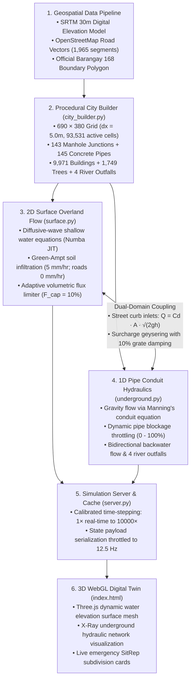

# Barangay 168 (Deparo, Caloocan City) 3D Flood Simulation System

[](https://www.python.org/)
[](https://fastapi.tiangolo.com/)
[](https://numba.pydata.org/)
[](https://threejs.org/)
[]()

A physics-based, dual-domain urban flood simulation digital twin for **Barangay 168 (Deparo, Caloocan City, Metro Manila, Philippines)**. The system pairs a high-performance **2D diffusive-wave shallow water surface engine** with a coupled **1D underground storm-drainage pipe network**, rendered in real time through an interactive WebGL / Three.js frontend.

---

## Table of Contents

1. [System Architecture](#1-system-architecture)
2. [Technology Stack & Framework Matrix](#2-technology-stack--framework-matrix)
3. [How the Simulation Works (End-to-End Lifecycle)](#3-how-the-simulation-works-end-to-end-lifecycle)
4. [Interactive 3D Digital Twin Manual & Features](#4-interactive-3d-digital-twin-manual--features)
5. [Global Parameters & Constants](#5-global-parameters--constants)
6. [Hydrologic & Hydraulic Physics Engine](#6-hydrologic--hydraulic-physics-engine)
   - [6.1 Surface Runoff (2D Diffusive Wave)](#61-surface-runoff-2d-diffusive-wave)
   - [6.2 Infiltration & Impervious Land Cover](#62-infiltration--impervious-land-cover)
   - [6.3 Drain Inlet Coupling (Surface to Underground)](#63-drain-inlet-coupling-surface-to-underground)
   - [6.4 Surcharge Backflow (Urban Geysering)](#64-surcharge-backflow-urban-geysering)
   - [6.5 Conduit Network Hydraulics (1D Saint-Venant)](#65-conduit-network-hydraulics-1d-saint-venant)
   - [6.6 Free Catchment Outfalls](#66-free-catchment-outfalls)
   - [6.7 Dual-Domain Mass Conservation](#67-dual-domain-mass-conservation)
7. [Simulation Timing & Speed Engine](#7-simulation-timing--speed-engine)
8. [GIS & Urban Synthesis Pipeline](#8-gis--urban-synthesis-pipeline)
9. [Emergency Management & SitRep Zones](#9-emergency-management--sitrep-zones)
10. [System Performance & Optimization Stack](#10-system-performance--optimization-stack)
11. [Directory & File Structure](#11-directory--file-structure)
12. [REST API Specification](#12-rest-api-specification)
13. [Installation & Verification](#13-installation--verification)

---

## 1. System Architecture



---

## 2. Technology Stack & Framework Matrix

The system integrates modern numerical computing, an asynchronous web service, and an interactive 3D WebGL engine:

| Layer / Subsystem | Technology | Version | Key Role & Implementation Rationale |
| :--- | :--- | :---: | :--- |
| **Numerical JIT Compiler** | **Numba** | `>= 0.68.0` | JIT-compiles 2D diffusive wave loops into parallel multi-threaded machine code (`@njit(parallel=True, nogil=True)`), bypassing the Python GIL for C-speed performance. |
| **Array & Tensor Compute** | **NumPy** | `>= 2.0` | High-density 2D elevation, roughness, water depth, and mask arrays with zero-copy vectorized operations. |
| **Scientific Interpolation** | **SciPy** | `>= 1.18.0` | Bivariate spline interpolation (`scipy.interpolate`) for elevation grid resampling from raw GeoTIFF DEMs. |
| **Geospatial Processing** | **Rasterio & GDAL** | `>= 1.5.2` | Extraction of georeferenced raster elevation matrices from SRTM 30m satellite elevation models. |
| **Vector GIS Geometry** | **Shapely** | `>= 2.0` | Spatial polygon clipping, road buffer unioning, and ray-casting point-in-polygon containment for barangay boundaries. |
| **Asynchronous Web API** | **FastAPI** | `>= 0.110.0` | High-throughput asynchronous REST API serving terrain, simulation state, pipe controls, and telemetry endpoints. |
| **ASGI Production Server** | **Uvicorn** | `>= 0.54.0` | High-performance ASGI web server handling HTTP requests concurrently with decoupled background physics workers. |
| **Data Validation** | **Pydantic** | `>= 2.0` | Strict schema validation for pipe blockage, diameter sizing, scenario selection, and speed requests. |
| **3D Graphics Engine** | **Three.js** | `r128` | WebGL 3D rendering pipeline: procedural terrain shaders, dynamic water elevation plane geometry, lighting, and camera orbit controls. |
| **Camera & Navigation** | **OrbitControls** | — | Smooth 3D perspective rotation, panning, and elevation tracking alongside a 2D orthographic top-down map mode. |
| **HUD & Billboard Sprites**| **HTML5 Canvas 2D** | — | Procedural dynamic texture synthesis for floating 3D subdivision risk labels and live color-coded status badges. |
| **Frontend Architecture** | **Vanilla ES6+ JS** | — | Clean, zero-dependency async client with decoupled 10 Hz polling, requestAnimationFrame render loop, and GPU texture dirty-checking. |
| **UI Styling & Layout** | **Modern CSS3** | — | Custom glassmorphic dark-theme design system, grid-based SitRep dashboards, and responsive control panels. |
| **Verification & QA** | **Python `unittest`** | Built-in | 6-stage automated test suite (`tests/verify_full_engine.py`) verifying terrain, pipes, zero-state, rainfall accumulation, blockage throttling, and mass balance. |

---

## 3. How the Simulation Works (End-to-End Lifecycle)

The system simulates the full physical path of urban stormwater from atmospheric cloudburst to river outfall:

```
[Rainfall Cloudburst] 
         │
         ▼
[Surface Inflow: P(t)] ──(Green-Ampt Infiltration: 5 mm/hr)──► [Soil Retention / Loss]
         │
         ▼
[Overland Runoff (2D Diffusive Wave)] ──► [Street Gutters & Topographic Lowlands]
         │
         ├──(Inlets Gated by Pipe Blockage)──► [Subsurface Manhole Shafts]
         │                                              │
         │                                   (Manning Conduit Flow)
         │                                              ▼
         │                                  [Underground Pipe Network]
         │                                              │
         ◄──(Surcharge Geysering: HGL > Rim)────────────┤
                                                        ▼
                                            [4 River Catchment Outfalls]
                                                        │
                                                        ▼
                                            [Discharge into River System]
```

1. **Precipitation Inflow**: Atmospheric rain falls uniformly across the active cells of Barangay 168.
2. **Infiltration & Runoff Partitioning**:
   - Paved asphalt roads are 100% impervious ($f = 0$); all rain becomes immediate surface runoff.
   - Pervious open grounds and residential lots absorb up to $5.0\text{ mm/hr}$ via Green-Ampt infiltration.
3. **Overland Gravity Routing**: Water pools and flows downhill following the 2D water-surface gradient ($\nabla(z + h)$) using Manning's open-channel friction equation. Runoff naturally concentrates in natural depressions such as the Alecon & Narra (Woodridge) valley bowl.
4. **Storm Drain Coupling**: Overland water reaching street inlets drains underground through curb openings and storm grates via the standard orifice equation ($Q = C_d A \sqrt{2gh}$). If downstream pipes are clogged by trash or debris, inlet capacity is automatically throttled down.
5. **Subsurface Pipe Conveyance**: Stormwater moves through 145 underground culverts driven by piezometric head differences ($\Delta H = H_{\text{in}} - H_{\text{out}}$). Flow naturally reverses if downstream head exceeds upstream head (bidirectional backwater).
6. **Surcharge Backflow (Urban Geysering)**: When pipes are full and the hydraulic grade line rises above the surface street rim ($\text{HGL} \ge z_{\text{rim}}$), pressurized water is pushed upwards out of manholes onto streets with a 10% damping factor to prevent numerical oscillation.
7. **Catchment Outfall Discharge**: Conduits terminate at 4 major river outfalls, permanently removing stormwater from the catchment and discharging it into open rivers.
8. **Real-Time Telemetry & Monitoring**: Every 100 ms, the 3D WebGL client updates depth contours, community disaster badges (`NORMAL`, `ALERT`, `WARNING`, `CRITICAL`), and mass balance metrics.

---

## 4. Interactive 3D Digital Twin Manual & Features

The WebGL frontend provides an interactive digital twin for disaster managers, urban planners, and civil engineers:

### 4.1 Viewport Navigation & Camera Controls
- **3D Perspective vs. 2D Top View**: Toggle between a cinematic 3D perspective camera (orbit, pan, zoom) and an orthogonal top-down 2D map view via the **`Switch to 2D Top View`** button.
- **Elevation Contour Heatmap**: Press **`Toggle Elevation Map`** to project a color-coded topographic terrain elevation gradient from lowland valleys (green/blue) to mountain ridges (yellow/brown/white).
- **Ground X-Ray Mode**: Press **`X-Ray Ground`** to render the terrain semi-transparent, revealing underground manholes, conduits, flow velocities, and pipe fill levels.
- **Layer Visibility Checkboxes**: Individually toggle 🏢 Buildings (9,971 structures), 🌲 Trees & Greenery (1,749 assets), 🛣️ Road Overlays, 💧 Dynamic Water, 🔴 Barangay Border, and 🔲 Subdivision Zone Boundaries.

### 4.2 Interactive Pipe Network Inspector & Clog Modeling
- **Click to Inspect**: Click on any underground conduit in 3D or 2D mode to inspect its properties:
  - Pipe ID, connected Node In $\to$ Node Out, Length, Base Diameter, Invert Elevation, and Hydraulic Slope.
  - Live instantaneous discharge rate ($Q$ in $\text{m}^3/\text{s}$) with directional flow indicator.
- **Dynamic Blockage Slider**: Drag the slider ($0\% - 100\%$) to simulate localized trash or silt blockage. The engine immediately throttles inlet intake and models upstream ponding.
- **Pipe Diameter Engineering Upgrade**: Type a new diameter ($0.1\text{ m} - 5.0\text{ m}$) and click **`Set Diameter`** to simulate the impact of widening municipal culverts.

### 4.3 Bulk Pipe Engineering Controls
- Apply blockage or diameter resizing across entire geographic catchment sectors:
  - Regions: `All Pipes`, `North Basin`, `South Lowlands`, `East Ridges`, `West Outfalls`.
  - Useful for testing city-wide infrastructure master plans (e.g., *"What happens if all culverts in the South Lowlands are enlarged to 2.5m?"*).

### 4.4 Weather Controls & Disaster Presets
- **Preset Disaster Scenarios**:
  - `Typhoon Ondoy Peak (150 mm/hr)`: Extreme tropical storm cloudburst.
  - `Habagat Heavy Monsoon (80 mm/hr)`: Sustained monsoon downpour.
  - `Convective Thunderstorm (50 mm/hr)`: Afternoon localized cloudburst.
  - `Main Culvert Failure (Pipe #0 Clogged 100%)`: Infrastructure failure scenario.
- **Custom Rainfall Slider**: Set manual precipitation rates ($0 - 250\text{ mm/hr}$) with optional automatic timer cut-offs.

### 4.5 Time Travel & Snapshot Rewind System
- **Speed Multipliers**: Seamlessly toggle between `1x`, `5x`, `25x`, `100x`, `500x`, `1000x`, `2000x`, `5000x`, and `10000x`.
- **Snapshot Rewind Dropdown**: The engine automatically records simulation snapshots every few minutes. Select any historical timestamp and click **`Go`** to instantaneously rewind the entire city state.

### 4.6 Emergency SitRep Dashboard
- **Live Telemetry HUD**: Displays Simulation Time, Active Flooded Cells, Maximum Depth, Total Water Volume ($\text{m}^3$), and Mass Balance Error ($0.00\%$).
- **Subdivision Risk Cards**: Real-time table ranking all 8 subdivision zones by inundation percentage and flood depth. Click any row to automatically focus the 3D camera onto that subdivision.

---

## 5. Global Parameters & Constants

All physical constants, coefficients, and numerical bounds across the engine are centralized in the matrix below:

| Parameter | Symbol | Value | Units | Description / Engineering Basis |
| :--- | :---: | :---: | :---: | :--- |
| **Gravity** | `g` | `9.81` | m/s² | Standard gravitational acceleration |
| **Grid Resolution** | `dx` | `5.0` | m | Lateral cell size (cell footprint area = 25 m²) |
| **Road Roughness** | `n_road` | `0.013` | s/m^(1/3) | Manning's roughness for asphalt roadway surfaces |
| **Soil Roughness** | `n_soil` | `0.040` | s/m^(1/3) | Manning's roughness for urban soils, lawns, and open lots |
| **Pipe Roughness** | `n_pipe` | `0.013` | s/m^(1/3) | Manning's roughness for precast reinforced concrete culverts |
| **Soil Infiltration** | `f_soil` | `1.4e-6` | m/s | Green-Ampt saturated conductivity (≈ 5.0 mm/hr in clay-loam) |
| **Road Infiltration** | `f_road` | `0.0` | m/s | Paved asphalt surfaces are 100% impermeable |
| **Detention Threshold**| `h_min` | `0.02` | m | 2 cm microtopographic capillary detention (prevents dry creep) |
| **Flux Safety Cap** | `F_cap` | `0.10` | — | Max 10% volume transfer per step (unconditional stability) |
| **Inlet Discharge Coeff** | `Cd` | `0.60` | — | Standard orifice coefficient for street storm grates |
| **Inlet Grate Area** | `A_inlet` | `0.05` | m² | Nominal hydraulic opening area per street drain grate |
| **Surcharge Damping** | `F_damp` | `0.10` | — | 10% per-step relief cap (prevents ping-pong oscillations) |

---

## 6. Hydrologic & Hydraulic Physics Engine

### 6.1 Surface Runoff (2D Diffusive Wave)

Overland flood flow is governed by the 2D Shallow Water Equations under the **diffusive wave approximation**. Bottom friction balances the hydraulic surface gradient:

```text
Friction Slope:
  Sx = -∂(z + h) / ∂x
  Sy = -∂(z + h) / ∂y

Unit Width Discharge (Manning's Equation):
  qx = (1 / n) · h_interface^(5/3) · √|Sx| · sgn(Sx)
  qy = (1 / n) · h_interface^(5/3) · √|Sy| · sgn(Sy)
```

| Variable | Definition | Unit | Physical Meaning |
| :--- | :--- | :---: | :--- |
| `z` | `elevation[r, c]` | m | Bare ground bed elevation from SRTM DEM |
| `h` | `water_depth[r, c]` | m | Water layer thickness above ground |
| `η = z + h` | `water_surface_head` | m | Total hydraulic piezometric head |
| `h_interface` | `0.5 · (h_current + h_neighbor)` | m | Interface flow thickness between adjacent cells |
| `n` | `0.013` (road) / `0.040` (grass) | s/m^(1/3) | Manning's surface friction factor |

#### Stability & Numerical Limiting

```text
Interface Flux Limiter:
  Flux_x = min( |qx| · dt,  0.10 · h_source · dx ) · sgn(qx)
  Flux_y = min( |qy| · dt,  0.10 · h_source · dx ) · sgn(qy)
```

- **Why Diffusive Wave?** Full dynamic wave models (with Riemann shock solvers) require sub-millisecond timesteps for numerical stability. The diffusive wave formulation captures true gravity pooling and backwater flow while remaining unconditionally stable at `dt` up to `10.0 s`, enabling ultra-fast fast-forwarding (`> 300×`).

---

### 6.2 Infiltration & Impervious Land Cover

Rainfall losses into native soils are evaluated using localized Green-Ampt infiltration:

```text
Infiltration Loss:
  Δh_infil = min( h,  f_rate · dt )

  f_rate = 0.0 mm/hr     (Road Mask = True)
  f_rate = 5.0 mm/hr     (Road Mask = False, urban clay-loam)
```

- **Impervious Roads**: Zero water infiltrates through asphalt. 100% of rain landing on street polygons converts to runoff.
- **Pervious Grounds**: Yards, open lots, and vegetation absorb up to 5.0 mm/hr, reducing peak surface accumulation.

---

### 6.3 Drain Inlet Coupling (Surface to Underground)

Street storm grates capture surface ponding and route it into underground manholes:

```text
Grate Inflow Rate:
  Q_inflow = Cd · A_inlet · √(2 · g · h)

Volume Captured per Step:
  V_inflow = min( Q_inflow · dt,  h · dx² ) · Ω_node
```

#### Dynamic Pipe-Blockage Gating

Drainage is throttled if the downstream underground pipes are obstructed by debris or trash:

```text
Conduit Openness Factor:
  Ω_node = max( 0.0,  1.0 - Average(Blockage of Connected Pipes) )
```

- If connected pipes are **0% blocked**, `Ω_node = 1.0` (full drainage).
- If connected pipes are **100% blocked**, `Ω_node = 0.0` (drain shuts off completely, surface ponding accumulates).

---

### 6.4 Surcharge Backflow (Urban Geysering)

When pipe conduits are overloaded or backwater builds up, manhole water can rise above ground level:

```text
Manhole Hydraulic Grade Line:
  HGL = z_invert + (Volume_shaft / Area_shaft)
```

#### Surcharge Activation Criteria

Backflow onto the street triggers **only** when all three physical conditions are met:

```text
1. Shaft Full to Rim:    HGL >= z_rim           (water reaches surface grate elevation)
2. Hydraulic Gradient:   HGL > (z_ground + h)   (shaft pressure exceeds street water head)
3. Available Storage:    Volume_shaft > 0.0     (shaft contains stored water)
```

#### Discharge Equation & Oscillation Damping

```text
Upward Discharge Rate:
  Q_surcharge = Cd · A_inlet · √(2 · g · [HGL - (z_ground + h)])

Damped Volume Transferred:
  V_excess = max( 0.0,  (HGL - z_rim) · Area_shaft )
  ΔV_step  = min( Σ Q_surcharge · dt,  0.10 · V_excess )
```

- **Why 10% Damping?** Ejecting 100% of above-rim water in a single step causes discrete numerical oscillation: water dumps onto the street, raising street head, then immediately drains back into the manhole next step. Damping at 10% spreads pressure relief smoothly over ~10 timesteps, mimicking the physical choking of small grate holes.

---

### 6.5 Conduit Network Hydraulics (1D Saint-Venant)

Underground storm pipes carry gravity-driven flow driven by the head difference between connected manholes:

```text
Head Difference:
  ΔH = H_upstream - H_downstream
  Sf = |ΔH| / max(Length, 1.0)

Pipe Discharge (Manning Conduit Equation):
  Q_pipe = sgn(ΔH) · [ A_eff · (R_eff)^(2/3) · √Sf ] / n_pipe
```

| Parameter | Formula / Value | Units | Description |
| :--- | :--- | :---: | :--- |
| **Effective Area** | `A_eff = (π·D² / 4) · (1.0 - Blockage)` | m² | Unblocked cross-sectional flow area |
| **Hydraulic Radius** | `R_eff = A_eff / [π·D · (1.0 - Blockage)]` | m | Ratio of flow area to wetted perimeter |
| **Culvert Roughness**| `n_pipe = 0.013` | s/m^(1/3) | Precast reinforced concrete culverts |
| **Backwater Flow** | `sgn(ΔH) < 0 ⇒ Q_pipe < 0` | m³/s | Automatic reverse flow when downstream head is higher |

#### Node Outflow Clamping

To prevent numerical overdrafting when multiple conduits drain the same manhole simultaneously:

```text
Outflow Scale Factor:
  Λ_node = min( 1.0,  Volume_node / (Σ |Q_out| · dt + 1e-12) )
  Q_pipe = Q_pipe · Λ_node
```

Node volumes are guaranteed non-negative (`Volume_node >= 0`) at all times.

---

### 6.6 Free Catchment Outfalls

The pipe network discharges into open creeks and rivers at **4 designated outlet nodes**:

```text
Cumulative River Discharge:
  V_discharged = Σ Volume_outlet
  Volume_outlet ← 0.0
```

Outfall volume clears freely to the atmosphere each step, simulating open-channel river conveyance.

---

### 6.7 Dual-Domain Mass Conservation

Total water across surface and subsurface domains is continuously tracked:

```text
Actual Volume in System:
  V_actual(t) = V_surface(t) + V_underground(t)
              = Σ (h_cell · dx²) + Σ Volume_node

Expected Volume in System:
  V_expected(t) = Cumulative_Rain - (Cumulative_Infiltration + Cumulative_Outfalls)

Mass Balance Error:
  Error (%) = [ |V_actual - V_expected| / max(Cumulative_Rain, V_actual, 1.0) ] · 100%
```

- **Verification Status**: `0.0000%` mass balance error confirmed in automated engine test audits.

---

## 7. Simulation Timing & Speed Engine

The physics loop features calibrated pacing supporting true real-time and extreme fast-forward speeds:

| Multiplier | Sub-step (`dt`) | Loop Pacing | Effective Rate | Purpose |
| :---: | :---: | :--- | :---: | :--- |
| **`1×`** | `0.05 s` | Paced sleep to 20 Hz (50 ms) | **`1.0 sim-s / real-s`** | True real-time live monitoring |
| **`5×`** | `0.25 s` | Paced sleep to 20 Hz (50 ms) | **`5.0 sim-s / real-s`** | Hydrograph progression |
| **`25×`** | `1.25 s` | Paced sleep to 20 Hz (50 ms) | **`25.0 sim-s / real-s`** | Moderate speed-up |
| **`100×`** | `2.00 s` | 150 ms wall-budget batch | **`~70×`** | Fast storm development |
| **`500×`** | `5.00 s` | 150 ms wall-budget batch | **`~160×`** | Extended rain events |
| **`1000×`** | `8.00 s` | 150 ms wall-budget batch | **`~260×`** | Multi-hour flood accumulation |
| **`5000×`** | `10.00 s` | 150 ms wall-budget batch | **`~330×`** | Accelerated dry-out |
| **`10000×`** | `10.00 s` | 150 ms wall-budget batch | **`> 300×`** | Multi-day recession curves |

---

## 8. GIS & Urban Synthesis Pipeline

All geography and urban assets are procedurally constructed from open geospatial data:

```
data/
├── barangay168_dem.tif   # Real SRTM 30m Digital Elevation Model (Caloocan North)
├── brgy168.geojson       # Official boundary polygon for Barangay 168 (Deparo)
└── roads_osm.json        # Real OpenStreetMap road network geometry (1,965 segments)
```

- **Topographic Matrix**: 690 × 380 grid cells (5.0 m resolution), 93,531 active cells within Barangay 168.
- **Elevation Range**: 4.36 m (southwest lowland basin) to 65.06 m (eastern ridge), mean: 33.25 m.
- **Drainage Infrastructure**: 143 manhole nodes, 145 concrete pipes (0.6 m – 1.2 m base diameter, resizable to 5.0 m), 4 river outfalls.
- **Urban Morphology**: 9,971 street-frontage buildings with realistic road setbacks; 1,749 natural trees on pervious greenbelts.

---

## 9. Emergency Management & SitRep Zones

Barangay 168 is partitioned into 8 community subdivisions, continuously monitored on the emergency dashboard:

| Community Subdivision | Area (ha) | Drainage Characteristics | Critical Flood Hotspots |
| :--- | :---: | :--- | :--- |
| **Deparo Proper (Sentro)** | 26.38 | Commercial hub, mid-elevation | Deparo Road & Sentro intersections |
| **Sto. Thomas & Casimiro** | 29.29 | Dense residential lowland basin | Casimiro Townhomes & Sto. Thomas Village |
| **Nova Romania** | 24.42 | Mid-elevation subdivision | Residential cul-de-sacs |
| **Alecon & Narra (Woodridge)** | 21.77 | Steep valley bowl; primary natural sink | Narra Street & Woodridge depression |
| **Precious Ruby & Natividad** | 28.27 | Central residential sector | Natividad Street & Precious Ruby sector |
| **Metro Green & Camarin** | 49.08 | Largest sector; arterial runoff corridors | Camarin Road corridors |
| **BF Homes Phase III** | 40.77 | Elevated ridge terrain | Outfall perimeter buffers |
| **Camella Altezza** | 13.84 | Western terrace development | Altezza perimeter slope base |

### Severity Classifications

The SitRep dashboard dynamically updates community flood status based on **active, real-time depth** (`h_current`), while the historical maximum is preserved independently in the **Peak Depth** column:

| Status Badge | Flood Depth | Physical Impact | Disaster Response Protocol |
| :---: | :---: | :--- | :--- |
| 🟢 **NORMAL** | `< 0.10 m` | Passable; road gutter flow | Standard monitoring |
| 🟡 **ALERT** | `0.10 - 0.30 m` | Ankle-deep ponding; gutter overflow | Traffic advisory issued |
| 🟠 **WARNING** | `0.30 - 0.80 m` | Knee-to-waist deep; light vehicles stalled | Evacuation preparation; emergency staging |
| 🔴 **CRITICAL** | `>= 0.80 m` | Waist to overhead; structural flooding | Mandatory rescue and evacuation |

---

## 10. System Performance & Optimization Stack

To maintain 60 FPS 3D rendering while running heavy 2D diffusive wave physics:

1. **Parallel Numba JIT Compilation (`surface.py`)**: Multi-core parallel execution with zero GIL contention (`parallel=True, cache=True`).
2. **Server JSON Byte Caching (`server.py`)**: Pre-encoded JSON response cached at 12.5 Hz (80 ms throttle). When sim tick is unchanged, pre-built bytes return directly without serializing.
3. **Frontend Polling Rate (`index.html`)**: Polling tuned to 10 Hz (100 ms), halving browser garbage collection pressure.
4. **Canvas Texture Dirty-Checking**: Zone label sprite canvases only redraw when text changes, eliminating redundant GPU texture uploads.
5. **Adaptive Snapshot Stride**: Memory-safe snapshot frequency scaling (`max(30.0, sim_speed * 2.0)`).

---

## 11. Directory & File Structure

```
Flood Control/
├── data/
│   ├── .gitkeep
│   ├── barangay168_dem.tif      # Real SRTM 30m Digital Elevation Model
│   ├── brgy168.geojson          # Official boundary polygon for Barangay 168
│   └── roads_osm.json           # Real OSM road network (1,965 features)
│
├── src/
│   ├── __init__.py
│   ├── server.py                # FastAPI backend, simulation thread, REST API & JSON cache
│   ├── engine/
│   │   ├── __init__.py
│   │   ├── simulator.py         # Sub-stepping time orchestrator with dynamic CFL limits
│   │   ├── state.py             # SimulationState dataclass (arrays, pipes, telemetry)
│   │   ├── surface.py           # 2D Shallow Water Equations (diffusive wave via Numba JIT)
│   │   └── underground.py       # 1D Saint-Venant hydraulic pipe network (Manning flow)
│   └── utils/
│       ├── __init__.py
│       └── city_builder.py      # Procedural GIS synthesis: DEM, roads, buildings, pipes
│
├── static/
│   ├── index.html               # Three.js 3D WebGL digital twin, telemetry HUD, inspector
│   ├── terrain_grass.png        # Procedural baked high-resolution terrain texture
│   └── terrain_roads.png        # Procedural baked road overlay texture
│
├── tests/
│   ├── .gitkeep
│   ├── test_simulation_zones.py # Subdivision boundary and zonal depth audit
│   └── verify_full_engine.py    # 6-part full physics, hydrology, and mass balance test suite
│
├── .gitattributes
├── .gitignore
├── CONTRIBUTING.md
├── LICENSE
├── main.py                      # Application launcher (Uvicorn on port 8000)
├── README.md                    # System architecture & physics documentation
└── requirements.txt             # Python dependencies
```

---

## 12. REST API Specification

### State & Geometry
- `GET /api/terrain`: Grid dimensions, elevation array, road masks, buildings, pipe graph, and zones.
- `GET /api/state`: Live 1D water depths, telemetry, pipe flows, node heads, and SitRep statuses.

### Simulation Control
- `POST /api/control`: Toggle simulation running state (Play / Pause).
- `POST /api/speed`: Set speed multiplier (`{ "multiplier": 100 }`).
- `POST /api/reset`: Reset all surface water, pipe volumes, and telemetry back to dry conditions.

### Weather & Hydrology
- `POST /api/rainfall`: Set continuous rainfall in mm/hr (`{ "mm_per_hr": 100.0, "duration_sim_hours": 2.0 }`).
- `POST /api/scenario`: Apply preset weather scenarios (Habagat storm, Typhoon Ondoy, pipe blockage).

### Pipe Engineering
- `POST /api/pipe/{id}/blockage`: Set conduit blockage percentage (`{ "blockage": 0.75 }`).
- `POST /api/pipes/bulk_blockage`: Apply blockage across multiple pipes (`{ "pipe_ids": [...], "blockage": 0.50 }`).
- `POST /api/pipe/{id}/diameter`: Resize conduit diameter (`{ "diameter": 2.5 }`).
- `POST /api/pipes/bulk_diameter`: Bulk-resize pipe diameters by region (`{ "region": "all", "diameter": 2.0 }`).

---

## 13. Installation & Verification

### 1. Setup Environment

```powershell
python -m venv venv
.\venv\Scripts\Activate.ps1
pip install -r requirements.txt
```

### 2. Run Verification Suite

Validate hydrology, pipe hydraulics, and mass balance across all 6 audit stages:

```powershell
python tests/verify_full_engine.py
```

Expected result:
```
=================================================================
  ALL SYSTEMS OPERATIONAL: Engine, Physics, Pipes, Water Depth   
  Topography, SitRep, & Mass Balance Are 100% Working & Accurate! 
=================================================================
```

### 3. Launch Digital Twin

```powershell
python main.py
```

Open your browser to: **`http://localhost:8000`**
